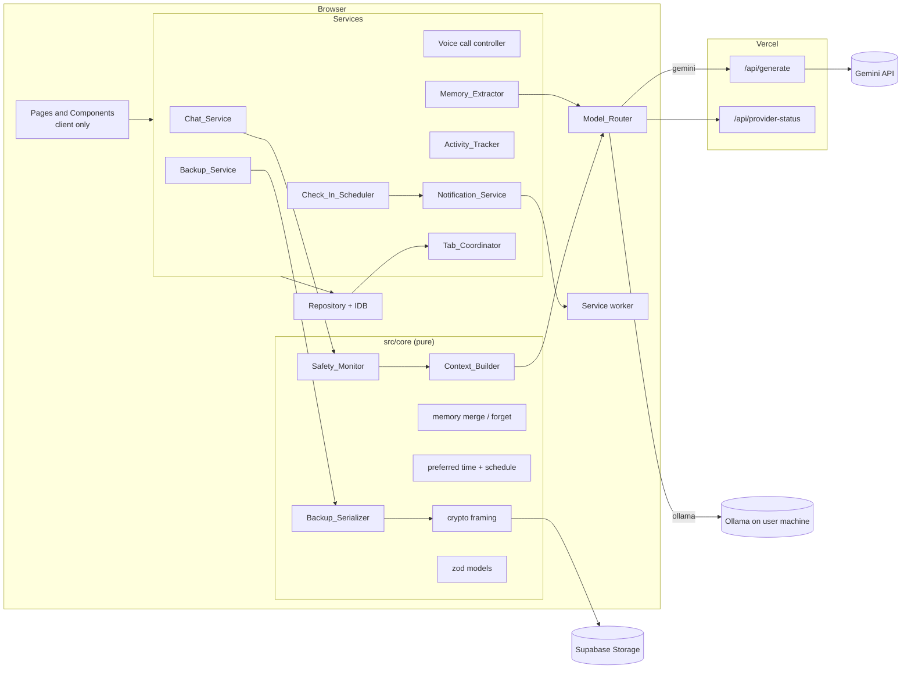
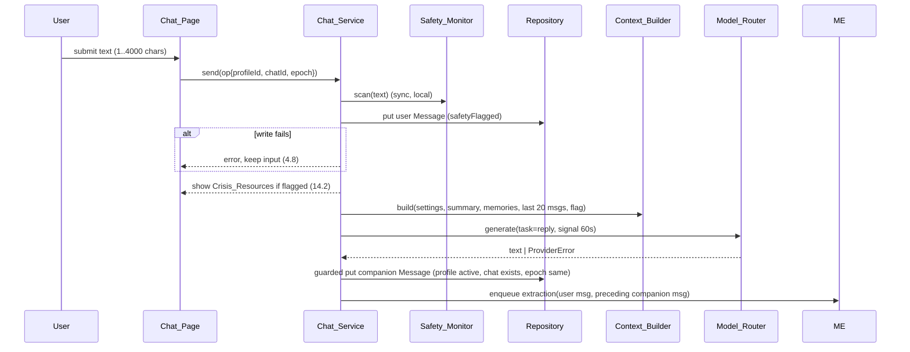
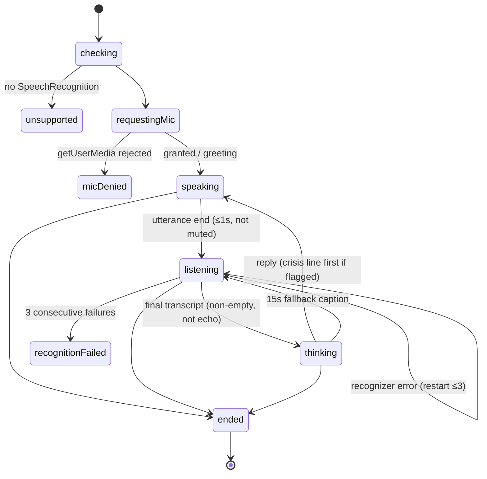

# Design Document: AI Companion Check-in

## Overview

AI Companion Check-in is a browser-first Next.js 15 app deployed on Vercel. Everything the user owns (Profiles, Chats, Memories, Activity_Logs, Settings) lives in IndexedDB. The server side is two stateless route handlers: `/api/generate` (Gemini proxy holding `GEMINI_API_KEY`) and `/api/provider-status`. Ollama is called straight from the browser. Backups are encrypted in the browser (AES-GCM, PBKDF2-derived key) and uploaded directly to the user's own Supabase Storage bucket.

Design goals:

- **Pure core, thin shell.** Validation, context building, memory merging/forgetting, scheduling, safety normalization, serialization, and crypto framing are pure TypeScript modules under `src/core/`. React, IndexedDB, Web Speech, and network calls sit in adapters around them. This is what makes the PBT properties cheap and meaningful.
- **One write path.** Every Local_Store write goes through a repository that validates with zod (Req 19.10–19.12), stamps the operation's `profileId`, runs in a single IDB transaction, and broadcasts the change to other tabs.
- **Zero-cost, zero-secret client.** No API key in the bundle; the only user-held credential is the Supabase anon key in the browser-level record.

### Key research findings

| Topic | Finding | Design impact |
|---|---|---|
| Gemini REST | `POST https://generativelanguage.googleapis.com/v1beta/models/{model}:generateContent`, key in the `x-goog-api-key` header; body uses `systemInstruction` + `contents[{role: "user"\|"model", parts:[{text}]}]`; quota errors are HTTP 429 `RESOURCE_EXHAUSTED` ([Gemini text generation docs](https://ai.google.dev/gemini-api/docs/text-generation), [API reference](https://ai.google.dev/api/generate-content)). Google now promotes a newer Interactions API, but `generateContent` remains the stateless REST path. | Header auth keeps the key out of URLs (Req 6A.11). Stateless calls, no server-side conversation storage (6A.12). `GEMINI_MODEL` lets the owner move off `gemini-2.0-flash` if Google retires it. |
| Ollama HTTP | `GET /api/tags` lists models; `POST /api/chat` with `{model, messages, stream:false, format?:"json"}` returns `{message:{content}}`; a missing model returns 404 with `model "<name>" not found`. Browser access from another origin requires `OLLAMA_ORIGINS`. | Health check = `/api/tags` with 2 s timeout. 404 + "not found" maps to `ModelNotInstalled` (6.13). |
| Browser → localhost from HTTPS | Chromium treats `http://localhost`/`127.0.0.1` as potentially trustworthy (no mixed-content block); recent Chrome versions may show a Local Network Access permission prompt. Safari/Firefox behaviour is stricter. | A failed `fetch` (TypeError) is classified as `Unreachable` (covers refused + CORS + LNA denial), driving the 6.9 fallback and 6.12 guidance. README recommends Chrome/Edge. |
| Web Crypto | PBKDF2-SHA-256 → AES-GCM-256 via `crypto.subtle.deriveKey`; GCM decrypt with wrong key/tampered data throws `OperationError`. OWASP currently recommends 600,000 PBKDF2-SHA256 iterations. | Iteration count stored in the object header so it can change later. `OperationError` → "passphrase incorrect or backup corrupted" (18.17). |
| Supabase Storage | `supabase-js` `storage.from(bucket).upload/list/download`; `createClient(url, key, { global: { fetch } })` accepts a custom fetch. | Custom fetch wrapper adds `AbortSignal.timeout(30_000)` (18.5, 18.9, 18.12) and is the single place that attaches the anon key, so it can only reach the configured URL (7.2). |
| Tab coordination | `navigator.locks.request(name, cb)` holds a lock until the callback's promise settles; when a tab closes, the lock is released and the next queued request is granted. | Leader election without heartbeats in the common case (20.1, 20.2). |

## Architecture



### Request flow for a chat reply



### Project layout (repository root = workspace root)

```
/                      package.json, next.config.ts, tsconfig.json, vitest.config.ts,
                       postcss.config.mjs, .env.example, .gitignore, README.md
public/sw.js           notification service worker
src/app/               layout.tsx, globals.css, page.tsx (Home), chat/page.tsx,
                       chat/[id]/page.tsx, call/page.tsx, settings/page.tsx,
                       memories/page.tsx, activity/page.tsx, profiles/page.tsx,
                       api/generate/route.ts, api/provider-status/route.ts
src/core/              pure logic (no DOM, no IDB) — all PBT targets
src/server/            gemini client, rate limiter, request schema, safe logger
src/data/              idb schema, migrations, repository, live-query hook
src/services/          chat, voice, memory, activity, scheduler, notifications,
                       backup, tab coordinator, model router + providers
src/components/        design-system primitives and feature components
tests/                 *.test.ts (unit) and *.property.test.ts (fast-check)
```

### Rendering and hydration strategy

`src/app/layout.tsx` is a server component that only sets fonts, metadata, and `<AppRoot>`. `AppRoot` is a `"use client"` provider that, inside `useEffect`, opens the DB, runs migrations, loads the browser record and Active_Profile, starts the Tab_Coordinator, and only then renders children. Until ready it renders a static skeleton that is identical on server and client, so there are no hydration mismatches and no IndexedDB access during SSR. Every page file is a client component; `/chat/[id]` reads its id via `useParams()`.

### Pinned dependencies (Node ≥ 20.19)

| Package | Version | | Package (dev) | Version |
|---|---|---|---|---|
| next | 15.5.28 | | typescript | 5.9.3 |
| react / react-dom | 19.1.10 | | @types/react / @types/react-dom | 19.3.0 |
| idb | 8.0.4 | | @types/node | 20.19.43 |
| zod | 3.25.76 | | @types/dom-speech-recognition | 0.0.12 |
| @supabase/supabase-js | 2.118.0 | | tailwindcss / @tailwindcss/postcss | 4.3.3 |
| geist | 1.8.1 | | postcss | 8.5.30 |
| | | | vitest | 5.0.5 |
| | | | fast-check | 4.10.2 |
| | | | fake-indexeddb | 6.2.6 |
| | | | jsdom | 30.1.3 |
| | | | @testing-library/react | 16.3.3 |
| | | | eslint / eslint-config-next | 9.39.5 / 15.5.28 |

Versions were taken from the npm registry when this design was written and are pinned without ranges in `package.json`.

## Components and Interfaces

### Model_Router and providers (Req 6, 6A)

```ts
type Task = "reply" | "extract_memories" | "summarize" | "test";
type Role = "user" | "companion";
interface GenerationRequest { task: Task; system: string; messages: { role: Role; content: string }[] }

interface ModelProvider {
  readonly id: "ollama" | "gemini";
  generate(req: GenerationRequest, signal: AbortSignal): Promise<string>;
}

type ProviderError =
  | { kind: "unreachable"; provider: "ollama" }               // TypeError: refused / CORS / LNA
  | { kind: "model_not_installed"; provider: "ollama"; model: string }
  | { kind: "timeout"; provider: ProviderId }
  | { kind: "busy"; provider: "gemini"; code: "rate_limited_local" | "gemini_quota"; retryAfterS?: number }
  | { kind: "unavailable"; provider: "gemini" }               // 503 / status route says no key / offline
  | { kind: "notice_declined" }                              // 6.22
  | { kind: "no_model" }                                     // 6.20
  | { kind: "upstream"; provider: ProviderId; status?: number };

interface ModelRouter {
  activeProvider(): ActiveProviderState;      // { id, fellBack: boolean, geminiAvailable }
  subscribe(cb: (s: ActiveProviderState) => void): () => void; // drives Provider_Badge (6.7)
  refresh(reason: RefreshReason): Promise<void>;               // health check + status route
  generate(op: OperationContext, req: GenerationRequest): Promise<string>;
  test(target: { provider: "ollama"; baseUrl: string; model: string } | { provider: "gemini" }): Promise<TestResult>;
}
```

Selection logic (pure, `src/core/providerSelect.ts`): `select(mode, health, geminiAvailable, online)` returns `ollama | gemini | none`. In auto mode a health check runs on start, profile change, mode/base-URL save, and lazily when the last check is older than 60 s (6.4). The router snapshots `{activeProvider, baseUrl, model}` at request start (6.10). In auto mode an `unreachable` Ollama error flips to gemini and resends once (6.9). Before the first gemini send per Profile, the router awaits a `PrivacyNoticeGate` promise resolved by the UI dialog; on continue it writes `geminiNoticeAcknowledgedAt` (6.21). Provider modes `ollama`/`gemini` hard-block the other transport (6.5, 6.6). Offline (`navigator.onLine === false`) marks gemini unavailable (20.16). All requests use `AbortSignal.timeout(60_000)` combined with a caller signal.

- **OllamaProvider**: `POST {baseUrl}/api/chat`, maps `companion → assistant`, prepends `system`, uses `format: "json"` for `extract_memories`.
- **GeminiProxyProvider**: `POST /api/generate` (same origin, relative URL only, 6.15). Maps status codes: 429 → `busy` (code from body), 503 → `unavailable`, 504/abort → `timeout`, else `upstream`.

### Generate_Route and Provider_Status_Route (Req 6A)

`src/app/api/generate/route.ts` (`runtime = "nodejs"`, `maxDuration = 60`, `dynamic = "force-dynamic"`). It exports `POST` plus explicit `GET/PUT/PATCH/DELETE/HEAD/OPTIONS` handlers that return 405 with `Allow: POST`. The POST pipeline is a pure-ish function `handleGenerate(req, deps)` with injected `env`, `fetch`, `now`, and `limiter` so it is unit- and property-testable:

1. Content-Type is not `application/json` → 415 `unsupported_media_type`.
2. `GEMINI_API_KEY` empty → 503 `gemini_not_configured` (6A.8).
3. Rate_Limiter (sliding window, `Map<ip, number[]>`, 20 per 60 s; IP from first `x-forwarded-for` entry, else `x-real-ip`, else `"unknown"`) → 429 `rate_limited_local` + `Retry-After` (6A.5, 6A.6).
4. `Content-Length` > 65,536 → 413 before reading; otherwise stream-read the body with a byte counter and abort at 65,537 bytes → 413 (6A.2).
5. `JSON.parse` failure → 400 `invalid_json`; zod `GenerateRequestSchema.strict()` failure → 400 `invalid_request` with `fields: string[]` (issue paths) (6A.3, 6A.4).
6. Call Gemini with `x-goog-api-key` header and `AbortSignal.timeout(50_000)`: abort → 504 `upstream_timeout`; 429 or `RESOURCE_EXHAUSTED` → 429 `gemini_quota`; other non-2xx → 502 `upstream_error`; success → 200 `{ text }` (6A.7, 6A.9, 6A.10).

```ts
const GenerateRequestSchema = z.object({
  task: z.enum(["reply", "extract_memories", "summarize", "test"]),
  system: z.string().min(1).max(20_000),
  messages: z.array(z.object({
    role: z.enum(["user", "companion"]),
    content: z.string().min(1).max(10_000),
  }).strict()).min(1).max(20),
}).strict();
```

Gemini mapping: `companion → model`; consecutive same-role turns are merged; a leading `model` turn gets a synthetic `user` turn `"(conversation start)"` because Gemini expects the conversation to begin with a user turn. `extract_memories` sets `generationConfig.responseMimeType = "application/json"`.

Key hygiene (6A.11, 6A.12): the key is read from `process.env` inside the handler, only placed in a header, and never interpolated into strings. `safeLog({ route, status, code, task, ms })` is the only logger and accepts only those fields. Upstream bodies are read only to detect `RESOURCE_EXHAUSTED` and then dropped. `/api/provider-status` exports `GET` → `{ geminiAvailable: boolean, model: string }` and 405 `Allow: GET` for other methods (6A.14).

### Context_Builder (Req 2.4, 9, 14.4, 15.1, 15.4, 6.24)

```ts
interface ContextInput {
  task: Task; botName: string; tone: Tone; summary: string | null;
  memories: Memory[];            // already filtered to op.profileId
  chatMessages: Message[];       // current chat, any order
  latestUserText: string; safetyFlagged: boolean; provider: ProviderId;
}
function buildContext(input: ContextInput): GenerationRequest;
function rankMemories(memories: Memory[], query: string, limit = 10): Memory[];
function trimToByteBudget(req: GenerationRequest, maxBytes = 65_536): GenerationRequest;
```

`system` is composed in a fixed order: persona block (Bot_Name and Tone verbatim, AI-not-human / not-a-therapist / no-diagnosis rules, encourage real-world relationships), optional safety instruction, then `## About the user` (Profile_Summary, omitted if empty), then `## Things you remember` (ranked Memories). Because the route schema has only `system` + `messages`, the "system prompt → summary → memories → messages" order of 9.1 is realized as sections inside `system` followed by `messages`. Ranking is local and zero-cost: normalized-token overlap score with the latest user message, ties broken by `updatedAt` desc then `id`; the top `min(10, n)` are kept regardless of score (9.2). Messages: the 20 most recent by `createdAt`, sent oldest first. For gemini, `trimToByteBudget` removes messages from the front (oldest) until `utf8Length(JSON.stringify(req)) ≤ 65,536`, never removing the final user message or touching `system` (6.24).

### Safety_Monitor (Req 14)

```ts
function normalizeForMatch(text: string): string; // NFKC, lowercase, drop apostrophes, \p{P}/\p{S} → space, collapse whitespace, trim
function detectCrisis(text: string): { flagged: boolean; matched: string[] };
```

A curated phrase list (e.g. "kill myself", "end my life", "want to die", "suicide", "hurt myself", "no reason to live") is normalized with the same function at module load. Matching is whole-word: `(" " + norm + " ").includes(" " + phrase + " ")`. No network access (14.6). The same `normalizeForMatch` is used for voice echo detection (20.31). Crisis UI: `CrisisPanel` (role `alertdialog`, non-modal, stays until dismissed) mounted in a page-level `SafetyProvider` so deleting a chat or a failed reply does not unmount it (14.8, 20.30). The fallback reply on failure while flagged is a static string naming 988.

### Memory_Extractor and Memory_Store (Req 8, 9.5–9.9, 10)

Pure functions in `src/core/memory.ts`:

```ts
function parseExtraction(raw: string): { ok: true; items: { category: Category; content: string }[] } | { ok: false };
function mergeMemories(existing: Memory[], items: Item[], src: { chatId: string; messageIds: string[] }, now: string, newId: () => string): { upserts: Memory[]; createdCount: number };
function appendCapped(list: string[], add: string[], cap = 100): string[]; // de-dupe, append, keep last 100
function forgetChat(memories: Memory[], chatId: string, chatMessageIds: Set<string>): { deleteIds: string[]; updates: Memory[] };
```

- `parseExtraction` accepts `{"memories":[...]}`; non-JSON or wrong shape → `ok:false` (treated as a router error, 20.26). Individually invalid items are dropped; at most 5 kept (8.1, 8.9).
- `mergeMemories` keys by `category + normalizeKey(content)` (trim + lowercase); duplicates update `updatedAt` and `appendCapped` sources (8.4, 8.10, 8.11).
- `forgetChat` removes the chat id and that chat's message ids from every memory; a memory whose `sourceChatIds` or `sourceMessageIds` becomes empty is deleted (10.3, 10.4). Deleting when only the message list empties is a deliberate "err toward forgetting" choice: it only happens after FIFO capping, and a memory with no source messages would violate Req 19.5.
- Extraction runs after a reply is stored, using the user message and the preceding companion message. Failures go into an in-memory retry queue (per tab, per message, max 3 attempts, drained after the next successful generation) (8.5).
- Results are written through a guarded transaction that re-checks the chat still exists, the profile is still active, and the restore epoch is unchanged (10.10, 20.7, 20.29).
- Summary regeneration triggers: chat end, `newMemoriesSinceSummary ≥ 10`, chat deletion, and app load when `summaryStale` is set. Output is truncated to 1,500 chars (9.6).

### Chat deletion (Req 10.2–10.9)

One `readwrite` transaction over `chats, messages, memories, summaries, profileMeta`: delete the chat and its messages, apply `forgetChat`, set the Profile_Summary content to `""`, and set `summaryStale = true`. Any failure aborts the whole transaction, so IndexedDB rolls it back (10.8). After commit, summary regeneration runs from the remaining memories; on success it writes the new summary and clears `summaryStale`; on failure the summary simply stays empty (10.9). Clearing the summary inside the delete transaction means the forgetting invariant (10.6) holds at every committed state, not only after regeneration. Deletion is refused while that chat has an active call (20.9).

### Repository and Local_Store (Req 16, 19, 20.4, 20.8)

```ts
interface OperationContext { profileId: string; chatId?: string; epoch: number }
interface Repo {
  put<S extends StoreName>(op: OperationContext, store: S, rec: RecordOf<S>): Promise<Result<void, RepoError>>;
  tx<T>(op: OperationContext, stores: StoreName[], fn: (t: TxApi) => Promise<T>): Promise<Result<T, RepoError>>;
  // reads are profile-scoped: listChats(profileId), messagesByChat(chatId, {limit, before}), ...
}
type RepoError = { kind: "validation"; model: string; fields: string[] } | { kind: "write_failed" } | { kind: "read_only" } | { kind: "stale" };
```

`put` validates with the model's zod schema, checks referential integrity inside the same transaction (19.12), rejects any record whose `profileId !== op.profileId` (20.8), and posts a `BroadcastChannel("companion-db")` message `{ stores, profileId, ids, deleted }` after `tx.done` resolves (20.4). The UI uses `useLiveQuery(query, stores)` which re-runs on local commits and on broadcast messages. A failed migration, a stored version higher than `SCHEMA_VERSION` (`VersionError`), or an unavailable IndexedDB puts the repo into `read_only` / `unavailable` mode; every mutating control reads `repo.mode` and disables itself (16.7, 16.8). `navigator.storage.persist()` and `estimate()` run at start and after each chat ends (20.19, 20.20).

### Activity_Tracker and Check_In_Scheduler (Req 11, 12, 15.5–15.8, 20.11–20.15)

Pure functions in `src/core/schedule.ts` take an explicit IANA `timeZone` so tests can exercise DST zones:

```ts
function localDate(instant: string, tz: string): string; // YYYY-MM-DD
function computePreferredTime(logs: ActivityLog[], trackingEnabled: boolean, override: string | null, tz: string): string; // "HH:MM"
function resolveLocalTime(date: string, hhmm: string, tz: string): string; // UTC instant; DST gap → first valid instant after; repeated → first occurrence
function evaluateSchedule(s: ScheduleState): ScheduleAction; // "none" | "trigger" | "snooze_reminder" | "prompt_on_open"
function activeSecondsOnDate(logs: ActivityLog[], inProgress: { startedAt: string } | null, now: string, tz: string): number; // clips across midnight
```

- `computePreferredTime`: override wins; otherwise needs tracking enabled and ≥ 3 distinct local dates. It takes the 14 most recent distinct local dates that have logs, counts session starts per local hour, and picks the max. Ties go to the hour of the most recent start among tied hours. The result is formatted `HH:00`, with `19:00` as the fallback.
- `evaluateSchedule` uses only today's `DailyCheckIn` record (keyed `[profileId, date]`). It triggers only if no record exists, or the record has no `triggeredAt`, and `now ≥ resolveLocalTime(today, preferred)`. A snooze reminder fires only if `snoozedUntil ≤ now`, `snoozeFiredAt` is empty, `completedAt` is empty, and the reminder falls on the same date. Earlier dates are never evaluated (20.15). The trigger is written to IndexedDB before the notification is shown, so a reload cannot double-trigger (12.8).
- The ticker runs every 15 s in the leader tab. Each tick compares local date and `getTimezoneOffset()` with the last tick (20.11). A wall-clock jump over 45 s, or `visibilitychange → visible`, is treated as a resume and evaluated right away (20.14).
- Completion: sending a chat message or starting a call upserts `completedAt` (12.9).
- Activity sessions: start on `visibilitychange → visible` (and at load if visible), end on `hidden`/`pagehide`. Logs are written only if tracking was enabled for the whole session; disabling tracking drops the in-progress session (11.3). The break suggestion is checked on every tick from `activeSecondsOnDate` including the in-progress session. It is deferred while a call is active, and `profileMeta.lastBreakSuggestionDate` prevents repeats (15.5–15.7).

### Notification_Service and service worker (Req 13)

`public/sw.js` handles `notificationclick`: it closes the notification, calls `clients.matchAll({type:"window"})`, focuses the first client and `postMessage({type:"open-call"})`, or `clients.openWindow("/call?from=checkin")`. The page uses `registration.showNotification(title, { body, tag: "checkin-" + profileId + "-" + date, data })`. The `tag` collapses duplicates. If registration fails, the page falls back to `new Notification()` (13.9). Permission is requested only from the settings toggle's click handler (13.1). Only the leader tab shows notifications (20.1).

### Tab_Coordinator (Req 20.1–20.5, 20.29)

- Leader: `navigator.locks.request("companion-leader", () => new Promise(() => {}))`. The tab whose callback runs is the leader until it closes. If Web Locks is unavailable, the fallback is a BroadcastChannel heartbeat (1 s, 3 s expiry, lowest tab id wins).
- Call exclusivity: `navigator.locks.request("companion-call", { ifAvailable: true }, ...)` plus a `call-state` broadcast so other tabs disable call controls (20.3).
- Deletions: the broadcast includes deleted ids; views for a deleted Profile/Chat navigate away and show a toast (20.5).
- Restore: increments a persisted `epoch` in the browser record and broadcasts `reload-all`; pending results carrying an older epoch are discarded (20.29).

### Voice call controller (Req 5, 14.3, 20.6, 20.17, 20.31)

The controller is a reducer-driven state machine (`src/core/callMachine.ts`, pure) plus an adapter around `SpeechRecognition` and `speechSynthesis`.



`muted` is an orthogonal flag: while muted the recognizer is stopped (not just ignored), and unmuting restarts it. Microphone permission is requested with `getUserMedia({audio:true})` (tracks stopped right away) before the recognizer starts. Late replies (15–60 s) are stored and captioned. They are spoken only if no `speechstart` occurred after the fallback caption (5.13, 5.14). Echo guard: a final transcript within 2 s of the end of speech that normalizes equal to the last spoken text is dropped. Switching Profile triggers `endCall()` and awaits the transcript save first (20.6).

### Backup_Serializer, crypto, Backup_Service (Req 7.9, 17, 18, 19.14–19.15)

```ts
function serializeBackup(data: BackupData, exportedAt: string): Promise<string>;   // canonical JSON
function parseBackup(text: string, byteLength: number): Promise<Result<BackupData, BackupError>>;
function encryptBackup(plain: Uint8Array, passphrase: string, opts?: { iterations?: number }): Promise<Uint8Array>;
function decryptBackup(blob: Uint8Array, passphrase: string): Promise<Result<Uint8Array, "decrypt_failed" | "bad_header">>;
type BackupError =
  | { kind: "too_large" } | { kind: "invalid_json" } | { kind: "unsupported_schema" }
  | { kind: "checksum_mismatch" } | { kind: "missing_field"; field: string }
  | { kind: "missing_parent"; recordType: string; ref: string } | { kind: "too_many_profiles" };
```

- Canonical JSON: `JSON.stringify(sortKeysDeep(v), null, 2)`. Every collection is sorted by `id` (settings, summaries, and profileMeta by `profileId`).
- Document shape: `{ checksum, exportedAt, schemaVersion, data }`. The checksum is SHA-256 hex over the canonical serialization of `{ exportedAt, schemaVersion, data }`, which is everything except the checksum (17.1). Parsing recomputes it.
- Parse order: size check (> 50 MB, before parsing), JSON, schema version, checksum, required fields (zod, unknown fields stripped), referential integrity, then ≤ 3 profiles (17.4–17.6, 20.27).
- Encrypted object layout: `"ACB1"` magic (4 B) ‖ PBKDF2 iterations uint32 BE (4 B) ‖ salt (16 B) ‖ IV (12 B) ‖ AES-GCM ciphertext + tag. Salt and IV come from `crypto.getRandomValues`. The default iteration count is 600,000. The passphrase and `CryptoKey` live only in function locals (18.18).
- Storage path: `{backupNamespaceId}/backup-{yyyyMMddTHHmmssSSSZ}-{rand6}.acb`. The timestamp-prefixed name makes `list(prefix, { limit: 50, sortBy: { column: "name", order: "desc" } })` newest-first (18.6). Size and created time come from the list response.
- Restore: decrypt, parse, confirm dialog, then one transaction that clears and refills all profile-data stores (`profiles, settings, chats, messages, memories, activityLogs, summaries, profileMeta`) and clears `checkIns`. It leaves `browser` and `backupMeta` untouched, then bumps the epoch (18.8, 19.14, 20.29).
- Backup_Service blocks every Cloud_Store request when offline, unconfigured, keyless, or when the passphrase length is outside 8–128 (7.3, 18.4, 18.16, 20.16). 401/403 or "Invalid JWT" style responses map to `key_rejected`, with no retry (7.7). Error strings shown to the user pass through `redactSecrets(msg, [anonKey])` (7.8).

### UI design system and pages

Tokens are defined once in `src/app/globals.css` using Tailwind v4 `@theme`:

```css
@theme {
  --color-bg: #FFFFFF;        --color-bg-subtle: #F7F8F7;
  --color-surface: #F1F3F2;   --color-surface-2: #E4E7E5;  --color-border: #D5DAD7;
  --color-text: #111814;      --color-muted: #5B6660;
  --color-primary: #14532D;   --color-primary-hover: #166534; --color-primary-deep: #0F3D22;
  --color-accent: #DCEBE1;    --color-danger: #B42318;
  --radius-sm: 6px; --radius-md: 8px; --radius-lg: 10px;
  --shadow-card: 0 1px 2px rgb(17 24 20 / 0.04), 0 1px 1px rgb(17 24 20 / 0.03);
  --font-sans: var(--font-geist-sans); --font-mono: var(--font-geist-mono);
}
```

Principles: 1 px `border` hairlines instead of heavy shadows. Headings use `tracking-[-0.02em]` and font-weight 600. Body text is 15 px/1.6. Geist Mono is used for timestamps, IDs, durations, the namespace id, and badges. Focus ring is `outline: 2px solid var(--color-primary); outline-offset: 2px` on `:focus-visible` everywhere (white on the call screen). All text/background pairs are AA. Muted `#5B6660` on `#FFFFFF` and `#F7F8F7` passes 4.5:1 for body text, and `#FFFFFF` on `#14532D` passes for buttons. Danger red appears only on errors, crisis UI, and End call. There are no gradients and no orange or purple. Motion respects `prefers-reduced-motion`.

Primitives (`src/components/ui/`): `Button` (primary / secondary / ghost / danger, 36 px and 44 px sizes), `IconButton`, `Card`, `Badge` (mono, 11 px, uppercase tracking), `ProviderBadge`, `Field` + `TextInput` + `Textarea` (with live counter), `Switch` (`role="switch"`), `Dialog` (native `<dialog>` with focus trap), `InlineAlert`, `Toast` (`aria-live="polite"`), `EmptyState`, `Skeleton`.

| Route | Content |
|---|---|
| `/` Home | Header row: profile name, Bot_Name, ProviderBadge, Help button (top right, always above the fold). Hero card: "Today's check-in" status badge, Preferred_Check_In_Time in mono, primary **Start call** and secondary **Open chat**. A prominent **Back up now** card with last-backup time/size in mono. Recent chats list (≤ 50). Persistent AI disclaimer footer. Inline check-in prompt, storage, and persistence notices. |
| `/chat`, `/chat/[id]` | Two-column at ≥ 1024 px (chat list rail, conversation); single column on mobile. Message bubbles: user on `accent`, companion on `surface`, mono timestamps. Typing indicator, 4,000-char counter, retry inline alert, "Load earlier" control past 500 messages, ProviderBadge, Help. |
| `/call` | Full viewport `#0F3D22`, white text. Centered avatar with concentric pulsing ring (steady soft ring while listening, stronger pulse while speaking, static while muted). Bot_Name, mono MM:SS timer, caption region (`aria-live`), and 64 px round Mute (white outline, `aria-pressed`) and End (danger fill) buttons. Help and ProviderBadge sit top right. |
| `/settings` | Sectioned page with a sticky in-page nav: Companion (name, tone segmented control), Model (provider mode, Ollama URL/model, test buttons, always-visible Gemini privacy + no-auth notice), Activity (consent, toggle, clear), Check-ins & notifications (override time, toggle), Cloud backup (Supabase URL, masked anon key, bucket, namespace id with copy/replace, RLS notice, Backup / Restore / Export / Import), Danger zone (reset profile, delete profile). |
| `/memories` | Filterable list by category badge, inline edit with 500-char counter, delete with confirm. Profile_Summary editor (1,500-char counter). |
| `/activity` | Table of sessions (mono times and durations), clear-all with confirm, disclosure text. |
| `/profiles` | Profile cards (≤ 3), create form, select, delete with name-confirm dialog. The zero-profile state also shows Restore/Import with inline Cloud_Store fields (20.21). |

## Data Models

All models are zod schemas in `src/core/models.ts`. TypeScript types are `z.infer`'d from them, and they are the single source for repository validation (19.10) and backup parsing. Timestamps are `z.string().datetime({ precision: 3 })` with UTC `Z` suffix (19.13). IDs are `crypto.randomUUID()`.

| Store (keyPath) | Indexes | Fields (beyond Req 19) |
|---|---|---|
| `profiles` (id) | `lastUsedAt` | — (19.1) |
| `settings` (profileId) | — | 19.2 **minus `cloudStoreConfig`** (see deviation) |
| `chats` (id) | `profileId`, `[profileId, updatedAt]` | — (19.3) |
| `messages` (id) | `[chatId, createdAt]`, `profileId` | — (19.4) |
| `memories` (id) | `profileId`, `sourceChatIds` (multiEntry) | — (19.5) |
| `activityLogs` (id) | `[profileId, startedAt]` | — (19.6) |
| `summaries` (profileId) | — | — (19.7) |
| `backupMeta` (id) | `createdAt` | — (19.8) |
| `checkIns` ([profileId, date]) | — | 19.9 **plus `snoozeFiredAt`** (empty or timestamp ≥ `snoozedUntil`) |
| `profileMeta` (profileId) | — | **new**: `activityConsent` (`opt_in` \| `opt_out` \| `dismissed` \| null), `newMemoriesSinceSummary` (int ≥ 0), `summaryStale` (bool), `lastBreakSuggestionDate` (YYYY-MM-DD \| null), `updatedAt` |
| `browser` (key `"singleton"`) | — | 19.15 **plus** `cloudStoreConfig` (null \| `{ supabaseUrl, supabaseAnonKey, bucketName }`) and `epoch` (int ≥ 0) |

```ts
export const SCHEMA_VERSION = 1; // IDB database version === schema version (16.3)

export const BrowserRecordSchema = z.object({
  id: z.literal("singleton"),
  backupNamespaceId: z.string().regex(/^[A-Za-z0-9_-]{22,64}$/), // ≥128 bits base64url (18.14)
  createdAt: Timestamp,
  epoch: z.number().int().min(0),
  cloudStoreConfig: z.object({
    supabaseUrl: z.string().url().startsWith("https://").max(2048),
    supabaseAnonKey: ApiKeySchema,                       // trimmed, 1..256, no internal whitespace (7.5)
    bucketName: z.string().regex(/^[a-z0-9-]{1,63}$/).default("companion-backups"),
  }).strict().nullable(),
}).strict();
```

### Design decision: `cloudStoreConfig` moves to the browser-level record (deviation from Req 19.2)

Req 19.2 places `cloudStoreConfig` inside per-Profile Settings. This design stores it in the single browser-level record next to `backupNamespaceId` instead. Reasons:

1. **Backups are browser-wide.** A Backup_Document contains every Profile (17.1) and lives under one browser-wide namespace (18.14). A per-Profile config would allow three different Supabase projects for one browser-wide backup, which is ambiguous.
2. **Zero-profile restore (20.21).** After eviction there is no Profile and so no Settings to hold credentials. A browser-level record covers this case directly instead of needing a special case.
3. **Secret exclusion by construction (7.9, 17.2, 19.14).** The browser record is never serialized (19.15), so the anon key cannot leak into a Backup_Document, and restore cannot overwrite it. Profile Settings then hold no secrets and can be backed up whole.
4. **Profile deletion** no longer silently removes the backup configuration.

Effect on requirements: the semantics of 18.1, 7.3–7.10, 19.14, and 20.21 are unchanged. Only the storage location named in 19.2 differs. The Settings page still edits these fields, labelled "Shared by all profiles in this browser". If the user wants the requirements text kept in sync, 19.2 and 19.15 should be amended to match.

### Other model notes

- `checkIns.snoozeFiredAt` and `profileMeta` are small additions the requirements imply but do not model. They track the one-snooze-reminder rule (12.7, 12.8, 13.5), the consent choice (11.7), the 10-new-memories trigger (9.5), the stale-summary flag (10.9), and the once-per-day break suggestion (15.7).
- Backup_Document `data` sections are `profiles, settings, chats, messages, memories, activityLogs, summaries, profileMeta`. `checkIns`, `backupMeta`, and `browser` are excluded.
- Migrations: `upgrade(db, oldVersion)` runs ordered steps `migrations[v]` for `v` from `oldVersion + 1` to `SCHEMA_VERSION` inside the version-change transaction. Any thrown error aborts the transaction, so the old data and version survive (16.6, 16.7).

## Correctness Properties

*A property is a characteristic or behavior that should hold true across all valid executions of a system-essentially, a formal statement about what the system should do. Properties serve as the bridge between human-readable specifications and machine-verifiable correctness guarantees.*

These properties target the pure modules in `src/core/` and `src/server/`, plus the repository over `fake-indexeddb`. Redundant criteria were consolidated during reflection. For example, the Context_Builder criteria from Req 2, 9, 14, 15, and 20 form a single property, and the validators for names, keys, URLs, and times form a single schema property.

### Property 1: Forgetting invariant

*For any* Local_Store dataset (multiple Profiles, Chats, Messages, Memories with arbitrary multi-chat sources) and any Chat C, after `deleteChat(C)` commits: no Message with `chatId = C` remains; no Memory's `sourceChatIds` contains C; every Memory whose sources were only C is gone; every other Memory that referenced C still exists with exactly its other source chats; the owning Profile's Profile_Summary is empty (pending regeneration from remaining memories); and all records of other Chats and other Profiles are byte-for-byte unchanged.

**Validates: Requirements 10.2, 10.3, 10.4, 10.6**

### Property 2: Source-cap invariant

*For any* Memory and any sequence of source appends (each adding a chat id and 1–2 message ids, with repeats allowed), every resulting Memory has 1–100 unique entries in both `sourceChatIds` and `sourceMessageIds`, the most recently appended ids are always present, and overflow removes only the oldest entries (the result equals the last ≤ 100 elements of the de-duplicated append order).

**Validates: Requirements 8.3, 8.10, 8.11**

### Property 3: Memory de-duplication

*For any* existing Memory set of a Profile and any batch of extracted items, after `mergeMemories` no two Memories of that Profile share the same `(category, trim(lowercase(content)))` key, and the number of Memories increases by exactly the number of distinct new keys in the batch.

**Validates: Requirements 8.4**

### Property 4: Extraction output parsing

*For any* model output string, `parseExtraction` returns `ok:false` when the string is not JSON of the expected shape, and otherwise returns at most 5 items, each with a category in {fact, mood, event, person} and trimmed content of 1–500 characters, equal in order to the valid items of the input.

**Validates: Requirements 8.1, 8.2, 8.9, 20.26**

### Property 5: Context builder limits, ordering, and required content

*For any* Bot_Name, Tone, optional Profile_Summary, Memory set (possibly containing other Profiles' memories), Chat of any length, and safety flag, `buildContext` produces a request where:

- `system` contains the Bot_Name and Tone verbatim and the AI-boundary and real-world-relationship instructions.
- The summary section appears if and only if the summary is non-empty.
- The memory section lists exactly `min(10, n)` memories of the active Profile only, in non-increasing relevance order.
- `system` contains the safety instruction if and only if the message is flagged.
- `messages` equals the last `min(20, len)` chat messages in ascending `createdAt` order.

**Validates: Requirements 2.4, 9.1, 9.2, 9.3, 9.4, 14.4, 15.1, 15.4, 20.22**

### Property 6: 64 KB trimming drops oldest first

*For any* generation request whose `system` plus latest user message fits within 65,536 bytes, `trimToByteBudget` returns a request whose UTF-8 JSON is ≤ 65,536 bytes, whose `system` is unchanged, whose `messages` is a suffix of the input `messages` that still ends with the latest user message, and which is the longest such suffix that fits. A request already under budget is returned unchanged.

**Validates: Requirements 6.24**

### Property 7: Safety_Monitor normalization

*For any* string s, `normalizeForMatch` is idempotent, and it gives the same result for s after changing letter case, inserting punctuation at word boundaries, or replacing single spaces with runs of whitespace. *For any* crisis phrase p from the list embedded in arbitrary surrounding text with such perturbations, `detectCrisis` returns `flagged: true`. The same equivalence decides voice echo discarding.

**Validates: Requirements 14.1, 20.31**

### Property 8: Generate route request validation

*For any* request body (random JSON, schema-valid bodies, near-miss mutations such as unknown fields, wrong enums, out-of-range lengths, or 0 / 21 messages, and random byte sizes around 64 KB) with a key configured and the limiter open, `handleGenerate` returns:

- 413 for bodies over 65,536 bytes.
- 400 with a non-empty `fields` list naming the failing paths for invalid JSON or schema failures.
- A call to the injected upstream fetch exactly once only for schema-valid bodies, and zero times otherwise.

**Validates: Requirements 6A.2, 6A.3, 6A.4**

### Property 9: Rate limiter window bound

*For any* sequence of (ip, timestamp) requests in non-decreasing time, the limiter allows a request if and only if fewer than 20 requests from that ip were allowed in the preceding 60 s. Consequently, every rolling 60 s window holds at most 20 allowed requests per ip, and rejected requests carry a `Retry-After` value between 1 and 60.

**Validates: Requirements 6A.5, 6A.6**

### Property 10: Server key hygiene

*For any* random `GEMINI_API_KEY` (16–64 chars) and any upstream outcome (success, 429, 4xx/5xx with bodies that echo the key or the request URL, network error, timeout), no response body, response header, or captured log entry contains the key or any substring of it of length ≥ 8. Every log entry contains only the fields `route, status, code, task, ms`.

**Validates: Requirements 6A.11, 6A.12**

### Property 11: API key masking and redaction

*For any* key string k of length n: `maskKey(k)` has length n; if n ≤ 8 every character is the mask character; otherwise exactly the last 4 characters equal those of k and the rest are mask characters. *For any* message m containing k, `redactSecrets(m, [k])` does not contain k.

**Validates: Requirements 7.4, 7.8**

### Property 12: Record validation accepts exactly the data models

*For any* record generated from the valid domain of each model in Req 19.1–19.9, the zod schema accepts it. *For any* such record with one field mutated outside its constraint (length, enum, regex, ordering such as `updatedAt < createdAt`, non-UTC timestamp), the repository rejects the write, names that model and field in the error, and leaves the stored version unchanged. The input validators (display name, Bot_Name, message text, Ollama URL/model, API key, HH:MM override) accept a string if and only if its trimmed form meets the stated bounds.

**Validates: Requirements 1.1, 1.7, 2.1, 2.6, 4.1, 4.6, 6.3, 6.14, 7.5, 7.6, 12.5, 19.1–19.11, 19.13**

### Property 13: Local store write/read round-trip

*For any* valid record of any store, writing it through the repository and reading it back by its key, including after closing and reopening the database, returns a value deeply equal to the written record, with all fields and millisecond timestamps preserved.

**Validates: Requirements 16.5, 2.8**

### Property 14: No cross-profile writes

*For any* interleaving of operations (send message, extraction result, summary result, call transcript) started under various Profiles, combined with Active_Profile switches, chat deletions, and restores that happen while results are in flight with random delays:

- Every committed record's `profileId` equals the profileId captured when its operation started.
- Results arriving after a profile switch, chat deletion, or epoch change commit no records.
- Context requests include only memories of the operation's Profile.

**Validates: Requirements 9.4, 10.10, 20.7, 20.8, 20.10, 20.29**

### Property 15: Backup round-trip and determinism

*For any* valid dataset (including zero Profiles and Profiles with empty collections) and fixed `exportedAt`:

- `serialize(parse(serialize(d)))` is byte-identical to `serialize(d)`.
- `parse(serialize(d))` yields records deeply equal to d.
- Serializing any permutation of d's collections, or of object key orders, gives identical bytes, with 2-space indentation and sorted keys.

**Validates: Requirements 17.1, 17.3, 17.7, 17.8**

### Property 16: Backups never contain browser-level secrets

*For any* dataset and any browser record (random anon key, Supabase URL, namespace id), the serialized Backup_Document contains none of the anon key, the `cloudStoreConfig` object, or the passphrase. Restoring any valid document leaves the browser record (including `cloudStoreConfig` and `backupNamespaceId`) deeply equal to its prior value.

**Validates: Requirements 7.9, 17.2, 18.18, 19.14, 19.15**

### Property 17: Backup error classification

*For any* valid serialized document and one applied corruption, `parseBackup` returns the matching error kind, and a subsequent Local_Store snapshot equals the prior snapshot. The corruptions and expected results are:

- Truncated JSON → `invalid_json`.
- Missing, non-integer, or unsupported `schemaVersion` → `unsupported_schema`.
- Any byte change inside `data` with the old checksum kept → `checksum_mismatch`.
- A removed required field → `missing_field` naming the first missing field.
- A Chat/Message/Memory parent id pointing outside the document → `missing_parent` naming the record type.
- More than 3 profiles → `too_many_profiles`.

**Validates: Requirements 17.4, 17.5, 20.27**

### Property 18: Encrypt/decrypt round-trip

*For any* plaintext byte array (0 B to 256 KB) and passphrase of 8–128 characters (including non-ASCII), `decryptBackup(encryptBackup(p, pw), pw)` returns bytes identical to p. Two encryptions of the same input differ in salt, IV, and ciphertext.

**Validates: Requirements 18.15, 18.20**

### Property 19: Wrong passphrase or tampering fails closed

*For any* plaintext and two distinct passphrases, decrypting with the wrong one returns `decrypt_failed`. *For any* single-byte change in the salt, IV, or ciphertext region, decrypting returns `decrypt_failed`. Neither case yields plaintext.

**Validates: Requirements 18.17**

### Property 20: Preferred check-in time

*For any* Activity_Log set, tracking flag, optional override, and IANA time zone, `computePreferredTime` equals a straightforward reference implementation:

- If an override is set, it returns the override.
- Otherwise, if tracking is off or the logs span fewer than 3 distinct local dates, it returns `19:00`.
- Otherwise it returns `HH:00`, where HH is the most frequent local start hour over the 14 most recent distinct local dates, with ties broken by the hour of the latest start.

**Validates: Requirements 12.1, 12.3, 12.4**

### Property 21: DST-safe local time resolution

*For any* date, HH:MM, and time zone (including zones with DST gaps and overlaps), `resolveLocalTime` returns the earliest instant whose local date equals the given date and whose local wall time is ≥ HH:MM. When the time exists, its local wall time equals HH:MM exactly. When it repeats, the earlier occurrence is returned.

**Validates: Requirements 20.12**

### Property 22: At most one check-in and one snooze reminder per date

*For any* sequence of scheduler events over several days (ticks at random times, reloads that keep only persisted state, preferred-time changes, snoozes, completions, app-open prompts, date and time-zone jumps, resumes after sleep):

- Each `(profileId, date)` gets at most 1 trigger (prompt-on-open counts as one) and at most 1 snooze reminder.
- A snooze reminder fires only at or after `snoozedUntil` on the same date.
- No trigger or reminder fires after `completedAt` for that date.
- No action is ever emitted for a date earlier than the current local date.

**Validates: Requirements 12.7, 12.8, 12.9, 12.10, 13.5, 20.15**

### Property 23: Daily active time clips at local midnight

*For any* Activity_Logs, optional in-progress session, instant, and time zone, `activeSecondsOnDate` equals the sum of each session's overlap with the local day `[00:00, next 00:00)`. It is never negative and never exceeds the local day's length (23, 24, or 25 h).

**Validates: Requirements 15.5, 15.8**

### Property 24: Provider selection

*For any* Provider_Mode, Ollama health result, gemini availability, and online state, `select` never returns gemini in `ollama` mode, never returns ollama in `gemini` mode, never returns gemini when offline or unavailable, and in `auto` mode returns ollama if healthy, else gemini if available, else `none`.

**Validates: Requirements 6.4, 6.5, 6.6, 6.20, 20.16**

### Property 25: Active profile selection and listing order

*For any* non-empty Profile list, the startup and post-deletion selector returns the Profile with the maximum `lastUsedAt` (ties broken by `id`) and returns `none` for an empty list. *For any* set of Chats and Messages, the Home list returns at most 50 of the active Profile's Chats sorted by latest message time descending, and `messagesByChat` returns messages in ascending `createdAt` order.

**Validates: Requirements 1.6, 1.8, 3.3, 4.4**

## Error Handling

Errors are typed values (`Result<T, E>`), not thrown strings, from the repository, router, backup service, and route handler. The UI maps each kind to fixed copy. Messages never interpolate secrets, and every Cloud_Store or provider error string is passed through `redactSecrets` before display.

| Source | Error kind | User-visible behavior | State guarantee |
|---|---|---|---|
| Repository | `validation`, `write_failed` | Inline alert "Not saved"; input text kept (4.8, 16.4) | Transaction aborted, no partial record |
| Repository | `read_only` (migration failed / newer version), `unavailable` | Persistent top banner; mutating controls disabled (16.7, 16.8) | Zero writes this session |
| Ollama | `unreachable` (auto) | Badge flips to "Gemini (hosted, Ollama not detected)", request resent once (6.9) | User message already stored |
| Ollama | `unreachable` (ollama mode) | Guidance with `OLLAMA_ORIGINS=<window.location.origin>` (6.12) | Conversation unchanged |
| Ollama | `model_not_installed` | Shows `ollama pull <model>` in mono with copy button (6.13) | — |
| Gemini route | 429 `rate_limited_local` / `gemini_quota` | "Hosted model is busy…" + retry; local limit shows Retry-After (6.18) | — |
| Gemini route | 503 / status unavailable | Gemini shown unavailable; zero generate calls (6.17) | — |
| Any provider | timeout, upstream, empty reply | "Couldn't get a reply from {provider}" + retry (4.7, 6.11, 6.19, 20.25) | User message kept, no companion message |
| Privacy gate | `notice_declined` | Inline explanation (6.22) | Zero route requests |
| Safety + failure | flagged and failed | Static 988 fallback reply shown; Crisis panel stays (14.8) | — |
| Voice | unsupported / mic denied / 3 recognizer failures | Explanation + "Open chat" button (5.9, 5.10, 5.12) | Transcript so far saved |
| Voice | > 15 s reply | Caption "I couldn't respond just now", listening resumes (5.11) | Late reply handled per 5.13/5.14 |
| Backup | `not_configured`, `no_key`, `offline`, `passphrase_length` | Message + link to Cloud backup settings (7.3, 18.4, 18.16, 20.16) | Zero Cloud_Store requests |
| Backup | `key_rejected` (401/403) | "Supabase rejected the API key" → Settings; no auto-retry (7.7) | Key retained |
| Backup | `timeout` (30 s), upload/list/download error | Error with redacted Cloud_Store message (18.5, 18.9, 18.12) | Metadata and Local_Store unchanged |
| Restore | `decrypt_failed` | "Passphrase is incorrect or the backup is corrupted" (18.17) | Local_Store unchanged |
| Restore/Import | `BackupError` kinds | Category-specific message (17.4–17.6, 20.27) | Local_Store unchanged |
| Tabs | item deleted elsewhere | Navigate away + toast (20.5) | — |
| Storage | persist denied / ≥ 80 % quota | Dismissible notice / warning with percentage (20.19, 20.20) | — |

Route handler errors always use the JSON shape `{ error: { code, message, fields? } }` with generic messages. Unexpected exceptions in the handler are caught at the top level and return 500 `internal_error`; only `safeLog` fields are logged.

## Testing Strategy

**Tooling.** Vitest with two projects. `core` uses `environment: "node"` for `src/core`, `src/server`, and the repository, with `fake-indexeddb/auto` and Node's built-in `crypto.webcrypto`. `ui` uses `environment: "jsdom"` with Testing Library for component and page examples. fast-check is the PBT library; no custom PBT framework. Run with `vitest --run`; `npm test` maps to that.

**Property tests.** Each of Properties 1–25 is implemented as a single `fc.assert(fc.property(...), { numRuns: 100 })` test (minimum 100 runs; the crypto properties use 100 runs with plaintexts capped at 256 KB and a test-only iteration count of 1,000, injected via `opts.iterations`, so they stay fast. The production default stays at 600,000). Each test carries a tag comment:

```ts
// Feature: ai-companion-checkin, Property 1: Forgetting invariant
```

Shared generators live in `tests/arbitraries.ts`:

- Valid datasets with consistent foreign keys (1–3 profiles, 0–20 chats, 0–30 messages per chat, memories with multi-chat sources).
- UTC millisecond timestamps.
- Time zones from a fixed list including `America/New_York`, `Europe/London`, `Australia/Lord_Howe` (30-min DST), `Asia/Kolkata`, and `Pacific/Chatham`.
- Unicode strings, including astral characters, for byte-length tests.
- Scheduler event sequences.

Time-dependent code takes `now` and `timeZone` as parameters, so no global clock mocking is needed in property tests.

**Example-based unit tests** (kept focused):

- Router fallback and privacy gate with mocked `fetch` (6.9, 6.21, 6.22).
- Provider error message mapping.
- Route method/content-type/503/504/502 handling (6A.1, 6A.7–6A.10, 6A.14).
- Chat send flow, including save-failure and retry (4.1–4.8).
- Chat-delete rollback with an injected failing transaction (10.8).
- Summary regeneration triggers (9.5, 10.5, 10.9).
- Activity session lifecycle with simulated `visibilitychange` (11.2, 11.3).
- Notification permission branches with a stubbed `Notification` (13.1–13.9).
- Call state machine sequences with fake `SpeechRecognition`/`speechSynthesis` and fake timers (5.1–5.14, 14.3, 20.6).
- Backup service with a mocked Supabase client: path prefix, list sort/limit, 30 s timeout, 401 handling.
- Tab coordinator with a `BroadcastChannel` polyfill and a Web Locks stub (20.3–20.5).

**Smoke checks** (in CI and before deploy):

- `next build` and `tsc --noEmit` pass with no errors (21.1).
- A script greps `.next/static` for `GEMINI_API_KEY`, the test key value, and `generativelanguage.googleapis.com` (7.1, 7.12, 6.15).
- A test asserts that the `headers()` in `next.config.ts` include the four security headers (21.10).
- A test checks that `.gitignore` covers `.env*` with an `!.env.example` exception (7.13).
- A test confirms `.env.example` contains only placeholders (21.4).

**Integration/manual** (not suitable for PBT):

- Leader failover across real tabs (20.1, 20.2).
- Service worker notification click (13.4, 13.7).
- Real Ollama with `OLLAMA_ORIGINS` set against the Vercel URL.
- A real Supabase bucket with RLS.
- The 10,000-message load-time budget (16.2).
- Voice calls in Chrome and Edge.

Accessibility is checked with keyboard-only passes, `axe` in component tests for focus and labels, and contrast checks of the token pairs. Full WCAG conformance still requires manual testing with assistive technologies and an expert review.

**Not tested automatically:** LLM reply content such as 15.2 ("I'm an AI" answers) is encouraged by the system prompt, which Property 5 verifies, but model compliance cannot be asserted deterministically.
